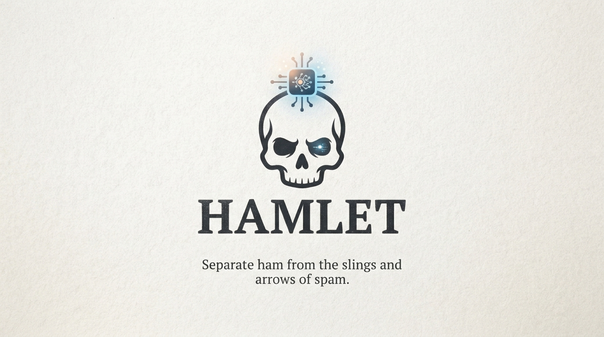

# Hamlet



Private email corpora for evaluating spam classifiers. Python 3.11+ with
`python-dotenv` for local configuration. Production classification and deployment
are not implemented yet.

See [project context and evaluation policy](docs/project-context.md) for goals,
release criteria, corpus assumptions, and the distinction between smoke tests
and final evaluation.

Install into a local virtual environment, then run from this directory:

```sh
python3 -m venv .venv
source .venv/bin/activate
python -m pip install -e .
export PYTHONPATH="$PWD/src"
python3 -m hamlet corpus init
python3 -m hamlet corpus export --host mail.example.com --account user-a --limit 20
python3 -m hamlet corpus inventory
python3 -m hamlet corpus verify
python3 -m hamlet corpus review --account user-a --folder INBOX --limit 100
python3 -m hamlet corpus label --account user-a --sha256 HASH --label ham
python3 -m hamlet corpus snapshot
python3 -m hamlet corpus group
python3 -m hamlet corpus group-report
python3 -m hamlet corpus group-show GROUP_ID
```

Default storage is `~/hamlet-data`, outside this project. Override with
`--data-root PATH` before `corpus`, or `HAMLET_DATA_ROOT`. Metadata and append-only
human reviews live in SQLite; original messages are content-addressed `.eml`
files. All exported material, manifests, and reviews are private. Back up the
entire data directory while no Hamlet command is writing to it.

## Credentials

Both corpus and evaluation commands automatically read `.env` in the current
working directory. Run from the project directory to use its configuration.
Create this local file from `.env.example` if it does not already exist, set
`HAMLET_DATA_ROOT`, `HAMLET_IMAP_HOST`, `HAMLET_IMAP_USERNAME`, and
`HAMLET_IMAP_PASSWORD`, and restrict its permissions with `chmod 600 .env`.
The template contains placeholders only; never commit the real `.env`.

Precedence is explicit command-line options, then existing process environment
variables, then `.env` values, then built-in defaults. Values are parsed as data,
never executed; interpolation is disabled so dollar signs in credentials remain
literal. Loading configuration does not modify the parent or process environment.
`.gitignore` excludes `.env` and `.env.*`, then explicitly re-includes
`.env.example` with `!.env.example`.

For legacy shell configuration, explicitly supply `--credentials-file ~/.bashrc`
and `--username-var NAME --password-var NAME`. Only the two selected literal
assignments and their simple `$NAME`/`${NAME}` references are resolved. The file
is never executed; command substitution and other shell expansions are rejected.
Configured environment/`.env` values take precedence over this legacy fallback.
Keychain integration is deferred; no credential storage is implemented.

## Export behavior

- TLS certificate verification, IMAP read-only selection, and `BODY.PEEK[]`.
  No moves, deletions, flag updates, or expunges.
- Defaults to ham-sample, Junk, INBOX, spam; repeat `--folder` to select folders.
- `--limit` caps **new** downloads per folder, newest UID first. It is a smoke-test
  limit, not a random sample. Omit for a complete export.
- Default run download budget: 2 GB (`--max-bytes`). Reaching the budget stops
  safely; rerun to continue. A message exceeding the budget requires increasing it.
- Every completed message is committed. Reruns skip stored account/folder/
  UIDVALIDITY/UID identities; UIDVALIDITY changes retain the old observations.
- Temporary connection failures reconnect with exponential backoff (1, 2, 4
  seconds by default), reselect read-only, and retry the failed operation.
  `--retries N` controls the retry limit. A UIDVALIDITY change during reconnect
  stops the run, rather than downloading a different message under the old identity.
  Authentication and certificate errors are not retried.
- Export is an archive, not a live mirror. Moved/deleted source entries remain
  recorded. Do not treat combined historical folder observations as current counts.
- Run one writer/exporter at a time. Interrupted writes can leave harmless
  unreferenced blobs; never delete files simply because they look duplicated.
- Inventory lists exact-content deduplication and conflicting folder labels.
  Provisional component-based development/test partitions are available through
  `corpus split`; a validated final holdout is still deferred.
- Inventory dates are IMAP INTERNALDATE, not guaranteed original delivery dates:
  server migrations and imports may reset them. The original Date header is also
  stored, but can be inaccurate or forged. Audit both before choosing a time split.
- Malformed headers cannot block raw-message storage. Metadata extraction falls
  back to unstructured header text, or empty fields if header parsing fails
  completely. `messages.metadata_warnings` records defect/error types without
  pretending the fallback is validated. Derived MIME normalization follows raw
  archival; original bytes remain untouched (see below).
- Invalid/missing IMAP dates are retained in `entries.raw_internal_date` where
  available, with `date_warning` set and normalized `internal_date` left empty.
  Inventory groups those entries under `unknown`, not an invented date.

Logs are timestamped, structured events on stderr. Errors include stage, folder,
UID, exception class, and stack locations, but never exception text, mail header
values, bodies, passwords, or stack locals. Redirect stderr into the private data
directory, not the repository. Warnings are not dropped messages.

Schema version 4 automatically migrates versions 1–3 while retaining entries and
reviews, with a pre-normalization SQLite backup under `snapshots/`. As before,
run only one writer at a time and back up data before updates.

Folder labels are provisional: INBOX/spam reflect classifier decisions;
Junk/ham-sample reflect user curation. Human reviews remain separate and
per-account. A ham-sample entry does not imply a historical false positive.

`review` produces a seeded, reproducible random list of distinct, unreviewed
messages from the **local exported population**, not from all server mail.
Read `.eml` files in a trusted offline viewer without loading remote content.
The list is for development review, not a reserved final holdout. Do not provide
raw mail to external services without an explicit data-handling decision.

Snapshots record source observations and all label events, not train/test splits.
Keep final-holdout mail out of prompt tuning; existing SpamAssassin verdict headers
must be deliberately handled before constructing classifier inputs.

## Attached-email normalization

SpamAssassin `report_safe` messages can contain the real email as an attachment.
Exports automatically create versioned local normalized views after archiving each
download; resuming an export also fills missing/current-version views for skipped
entries without downloading them again. To normalize an existing local corpus:

```sh
python3 -m hamlet corpus normalize
python3 -m hamlet corpus normalization-report
python3 -m hamlet corpus verify
```

Run one writer at a time. `corpus group` ensures normalization is current first.
No credentials, network requests, models, or remote content are involved.
`messages/`, source hashes, folder observations, and review labels are never
rewritten. Derived messages live separately in private, content-addressed
`derived/` files; `normalized_messages` records source/effective hashes, statuses,
metadata, extraction paths, serialization provenance, and fixed-code warnings.
Private, content-free aggregate reports are stored under `runs/normalization-*.json`.
The normalization identity includes implementation hashes and the Python version;
algorithm changes retain older views. `verify` checks both original and derived
file sizes/hashes, including historical derived versions.

Recognition requires canonical report prose plus independent SpamAssassin
metadata. Subjects or forwarded `message/rfc822` attachments alone are insufficient.
Recognizable `message/rfc822`, original-described text attachments, and `.eml`
attachments with safe MIME types are supported. Multipart/mixed and recognizable
multipart/alternative reports can be recursively unwrapped. Recognition is not
sender authentication.

Each successful layer records source/extracted SHA-256, zero-based MIME child
indices, and a serialization indicator. `message/rfc822` uses stdlib
`BytesGenerator`, compat32 policy, LF line endings, no header line-length limit,
and no `From ` mangling: **it is not byte-exact extraction**. Text/octet-stream
originals retain their MIME transfer-decoded payload bytes. Originals remain
available for wire-level, signature, or forensic checks.

Statuses are `unchanged`, `unwrapped`, `ambiguous`, `malformed`, and `limited`.
Suspected/incomplete reports, multiple or missing originals, corrupt transfer
encodings, parser defects, and resource limits cannot silently fall back to
grouping report boilerplate. An unsuccessful layer preserves its input (or the
last successfully extracted layer); only `unchanged`/`unwrapped` are eligible for
grouping. Conservative limits are 5,000,000 bytes per message, eight wrapper
layers, 512 outer MIME parts, depth 32, and 100,000 bytes of report prose.
Unrecognized historical/custom report formats may remain unchanged.

Grouping uses effective content and inner reference headers while keeping source
hashes as membership identities. Matching safe textual CRLF/LF variants can share
a derived grouping identity; binary/unencoded non-text parts, signed/encrypted
containers, and parser uncertainty retain exact-byte identity. This is not a
source-identity or signature-equivalence claim. Conflicting labels across equivalent
effective content are reported and excluded, never corrected automatically.
Attached message subtrees in ordinary forwards are not included in body-text
grouping. Verdict headers remain in stored views: classifier inputs must remove
or deliberately handle this label leakage separately.

## Related-message grouping

Pause export and other writers before `corpus group`. Grouping proposes
relationships without changing labels or assigning any dataset splits. Each run
is tied to a corpus/label snapshot, parameters, implementation hash, and Python
version. Downloading more mail or reviewing labels requires a new run to include
those changes.

- **Ham:** connected components of Message-ID, References, and In-Reply-To links.
  Siblings sharing an absent ancestor are linked. Matching subjects or senders
  alone never merge threads.
- **Spam:** normalize visible text, HTML links, recipient local parts, numbers,
  and long hex tracking identifiers; compare five-word shingles. Exact normalized
  templates and near-duplicates become campaign *candidates*. MinHash/LSH finds
  likely matches without all-pairs comparisons. Candidate indexing is approximate,
  but each accepted near-match must meet the configured Jaccard similarity
  threshold against its group's anchor (default 0.85, `--spam-threshold`).
  Chained A~B~C similarity cannot merge C into A unless C also matches anchor A.
- Process each account separately. Latest explicit reviews override folder labels.
  Unreviewed conflicting folder labels and explicit `unsure` reviews are excluded
  and reported. Folder-derived labels remain provisional.
- Malformed encodings/MIME use defensive fallbacks. Attachments are excluded, and
  no scripts, remote images, links, or other remote content are executed/fetched.
  Too-short, unreadable, oversized, or truncated bodies stay singletons instead of
  receiving speculative matches. All limits and fallback counts are reported.

`grouping_runs`, `corpus_groups`, and `group_members` store versioned results,
membership evidence, and anchor similarity. Private JSON reports under
`~/hamlet-data/runs/grouping-<run-id>/report.json` show coverage, size distributions,
largest groups, conflicts, and parsing/limit counts without message bodies or
subjects. `group-report` defaults to the latest run; `--run-id` selects an older
run. `group-show GROUP_ID` lists hashes and local paths for auditing members.

These are not verified real-world campaign identities. Missing/forged reference
headers, shared boilerplate, approximate candidate retrieval, and content
normalization can produce over/under-grouping. Audit groups before using them to
prevent split leakage. Future pooled datasets must also keep cross-account exact
duplicates together where the systems share learned state. A partial export gives
only a partial view of groups.

## Validation

```sh
PYTHONPATH=src python3 -m unittest discover -s tests -v
```

## Local model smoke evaluation

Completed runs are summarized in the [evaluation log](docs/evaluations.md).

Generate the current normalized grouping and provisional group-disjoint split:

```sh
PYTHONPATH=src python3 -m hamlet corpus group
PYTHONPATH=src python3 -m hamlet corpus split --test-fraction 0.2
```

The split joins related-message groups and global effective-content duplicates
into indivisible components, then assigns newer components to test within label
strata. It excludes unsafe extractions and unresolved/conflicting labels.
Reports include source-folder provenance and a seeded, identity-distinct sample
of 1,000 ham and 1,000 spam when sufficient test records exist. Internal dates can
reflect imports rather than arrival; this is not yet a certified final holdout.

The initial runner calls **only loopback Ollama**, with no hosted provider, judge
model, telemetry, or raw-mail logging. It uses the installed `llama3:latest` 8B
quantized model by default. This is a timing/token smoke test, not a release gate.
The versioned `spam-v1` prompt renders selected headers and bounded visible text,
excludes SpamAssassin verdict headers and attachments, and requests binary JSON.
The caller supplies normalized originals, never the outer SpamAssassin report.
Long messages are truncated; model context limits can further truncate input.

After generating a grouped split and its balanced benchmark manifest:

```sh
PYTHONPATH=src python3 -m hamlet.evaluation /private/path/to/benchmark.json
```

The benchmark must contain `records` with exactly 1,000 each `ham` and `spam`,
`partition: "test"`, source/effective hashes, account, and `effective_path`.
Only files inside `--data-root` (default `~/hamlet-data`) are accepted and their
effective hashes are checked. The model digest, prompt/runner implementations,
manifest, seed, and context limits identify the run. Private artifacts under
`runs/eval-<id>/` include parameters, resumable per-message prediction JSONL,
and aggregate `report.json`. They contain hashes/labels/timing/counters, not
email text or raw model output. Each prediction is flushed and fsynced.
Use one writer per run; rerunning the same command skips completed predictions.

Reports distinguish measured wall time, Ollama model/load/token timing, input
and generated token counters, cached tokens, invalid outputs, and confusion
counts. Local API fees are $0; electricity/hardware are not measured. To explore
hosted prices without making hosted calls, pass `--input-usd-per-million RATE`
and `--output-usd-per-million RATE`. These are hypothetical prices using Ollama
token counts, not a quote: provider tokenization/caching differs.

Even zero false positives among 1,000 ham gives a one-sided 95% upper bound of
about **0.299%**, which does not establish the 0.1% target. Labels are provisional,
group dependence matters, and this test set must not be called a final holdout.

Framework research favors retaining this minimal runner initially. Revisit
[Inspect AI](https://github.com/UKGovernmentBEIS/inspect_ai) (MIT, Python, Ollama,
custom scorers) when multiple providers/experiment tooling justify dependencies;
its default evaluation logs may contain samples and require private paths.
[Promptfoo](https://github.com/promptfoo/promptfoo) (MIT, Node, Ollama) is another
option, but disable telemetry/update checks for sensitive corpora.
[DeepEval](https://github.com/confident-ai/deepeval) (Apache-2.0) is more
judge-oriented and also needs telemetry opt-out. None provides Hamlet's
leakage-safe splits and statistical release criteria automatically.
